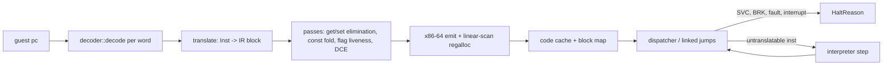

# A64 JIT design

This is the plan for `lichii-cpu`'s JIT. It sits behind the existing `CpuCore` contract, reuses the decoder's `Inst` stream, and keeps the interpreter as both its fallback and its test oracle. Nothing here changes a cross-crate contract. The proposals that would touch one are listed at the end and go through the Captain first.

## Goals

- Run Switch 1 and Switch 2 titles at full speed on x86-64 hosts (Linux and Windows), with the interpreter used only for code the JIT cannot translate yet.
- Bit-exact with the interpreter: every translated block must produce the same `ThreadContext` and memory as interpreting it. The differential suites enforce this.
- Remove the costs Lichii's dynarmic paid, as recorded in `NX2_NOTES.md`:
  - Row 3: LSE atomics, `CAS` and `SWP` ran as exclusive load/op/store retry loops. Here they become single host atomics on fastmem.
  - Rows 111 and 127: `CNTPCT_EL0` reads cost 10-23% of the main core. Here the counter is read inline, without a call out.
  - Row 109: ~1,400 SVCs per frame. Here leaving the JIT is a plain return, because the guest state already lives in `ThreadContext`.
  - Rows 115 and 150: page protection for GPU-tracked memory. Here fastmem faults go to a slow path per access site and do not crash the core.

Not goals for the first version: an AArch64 host backend (the IR stays host-neutral, so one can be added later), cycle-accurate timing, and translating SIMD/FP natively (the SIMD crew's `simd::execute` is called as a helper at first).

## Pipeline

Block boundaries are the interpreter's (`Inst::ends_block`, page ends), plus any instruction the translator rejects. A rejected instruction ends the block before it, and the dispatcher interprets that one instruction with `Exec::execute` before it re-enters translated code. So any decodable instruction always runs, and new IR coverage can grow one instruction class at a time.

## IR

The IR is SSA inside one block. There is no cross-block IR, and each block is a flat `Vec<IrInst>` that refers to values by index.

- **Types**: `U1`, `U8`, `U16`, `U32`, `U64`, `U128`, `Nzcv` (a packed 4-bit value), and `Void`.
- **State access**: `GetReg(r)`, `SetReg(r, v)`, `GetSp`/`SetSp`, `GetNzcv`/`SetNzcv`, `GetVec(n)`/`SetVec(n, v)`, and `GetSys`/`SetSys` for FPCR, FPSR and TPIDR. Writes to `ZR` are never emitted; the translator drops them using `Reg::ZR`.
- **Arithmetic**: add, sub, adc and sbc, each with an optional `Nzcv` result. Also logic ops, shifts and rotates with A64 semantics (amount masked by the width), extends, mul/umulh/smulh, udiv/sdiv with A64's divide-by-zero and overflow results, clz/cls/rbit/rev, select, the bitfield move (`(src ror r) & wmask` merges, folded at translate time because `immr`/`imms` are constant), crc32.
- **Conditions**: `TestCond(cond, nzcv) -> U1`.
- **Memory**: `Load{size, signed, order}` and `Store{size, order}` on a `U64` address. `order` is plain, acquire or release. Pair accesses are two ops on adjacent addresses.
- **Atomics**: `AtomicRmw{op, size}`, `Cas{size}`, `Cas128`, `ExclusiveLoad{size}`, `ExclusiveStore{size} -> U1`, `ClearExclusive`, `Fence`.
- **Calls**: `CallSimd(word)` runs `simd::execute` on the live context, `CallClock`, and `CallHelper(fn)` for rare operations (`DC ZVA`, structure loads at first).
- **Terminals** (exactly one, at the end): `Jump(const pc)`, `JumpIndirect(v, hint)` where the hint is `Ret`, `Call` or `Other`, `Branch(cond, taken pc, not-taken pc)`, `Halt(SupervisorCall | Breakpoint | Undefined)`, `Interpret(pc)`, `Invalidate(range)`.

Using an IR instead of emitting x86 straight from `Inst` is what makes the flag and register passes possible. Most A64 `ADDS`/`SUBS` flags are dead before they are read, and most guest registers are reused within a block.

## Passes

Each pass is a function `fn(&mut Block)`. They run in this order:

1. **Get/set elimination**: forwards the last `SetReg` to later `GetReg`s of the same register, drops dead `SetReg`s that a later write in the same block overwrites, and does the same for NZCV and the vector registers.
2. **Constant folding and propagation**: folds pure ops on immediates, `ADRP + ADD` address chains, `MOVZ/MOVK` sequences and conditions on known flags. A `Branch` with a known condition becomes `Jump`.
3. **Flag liveness**: removes the `Nzcv` outputs nobody reads before the next full write. Within a block that is the common case. At block exits flags stay live unless the successor is known to overwrite them; that refinement comes later.
4. **Dead code elimination**: drops pure ops with no users. Memory ops, atomics, calls and terminals are roots.
5. **Peepholes for the backend**: fuses `SUBS`/`ADDS`/`ANDS` with the `TestCond` that consumes its flags into one x86 `cmp`/`test` + `jcc`/`setcc`/`cmovcc`, skipping the packed `Nzcv` value.

Pass tests run each block both with and without each pass, through the backend, and compare results. That turns every pass into its own differential test.

## Guest state and host registers

The JIT works directly on the existing `ThreadContext`, which is `#[repr(C)]`, plus a small `JitState` next to it: the halt flag, the return stack buffer and the scratch spill area. No copy is made on entry or exit.

| Host register | Use |
|---|---|
| `r15` | `&mut ThreadContext` (guest X0-X30, SP, PC, NZCV in `pstate`, V0-V31, ...) |
| `r14` | fastmem arena base (`Fastmem::base`) |
| `r13` | `&JitState` |
| `rax rcx rdx rbx rsi rdi rbp r8-r12` | allocatable |

The register allocator is a linear scan over the block's SSA values. Guest registers are loaded lazily from `[r15 + off]` and written back at exits and before helper calls, which are the only points where the context must be exact. Values live across a helper call go to callee-saved host registers or to the spill area.

Both host ABIs are supported. The entry trampoline saves the callee-saved set of whichever ABI is in use (System V: `rbx rbp r12-r15`; Win64 adds `rsi rdi xmm6-xmm15`), and helper calls go through a per-ABI shim that handles Win64's 32-byte shadow space. The emitted block code itself is ABI-independent.

## Memory

- **Fastmem**, whenever `AddressSpace::fastmem()` is `Some` (the default; `Settings::cpu.fastmem`): a load is `shr tmp, 39; jnz slow; mov dst, [r14 + addr]`. The bounds check costs one predicted branch. It stops a guest address at or above `2^address_space_bits` from reaching host memory outside the arena, so it is never removed, whatever `CpuAccuracy` says. Unaligned accesses are fine on x86-64.
- **Faults**: the JIT registers a `FaultHandler` on the arena with `Fastmem::set_fault_handler`. The handler maps the faulting host pc to its access site through a sorted, immutable `(host_pc, site)` table published per code buffer. That is a binary search with no allocation and no locks, as the `FaultHandler` contract requires. It then moves the host pc to the site's out-of-line slow path with `HostFault::set_pc`. The slow path calls `AddressSpace::read`/`write`, so MMIO-like trapped pages (rows 115 and 150) work, and a real fault becomes `CpuFault::Data` with the exact guest pc, which comes from the site table.
- **No fastmem**: the same site emits an inline walk of the two-level page table with a slow-path call on a miss. The JIT asks `lichii-memory` for no new API; the inline walk uses the same `translate` semantics as a helper first and is specialised later.
- **Acquire/release**: on x86-64 these are compiler-ordering only. `DMB`/`DSB` become `mfence`.

## Atomics and exclusives

- `LDADD` is `lock xadd` and `SWP` is `xchg`. `LDCLR`, `LDEOR`, `LDSET` and the min/max ops are `lock cmpxchg` loops. `CAS` is `lock cmpxchg` and `CASP` is `lock cmpxchg8b`/`cmpxchg16b`. All of them work on the fastmem pointer after an inline alignment check, so a misaligned access gives `CpuFault::Alignment` exactly as in the interpreter. This replaces dynarmic's exclusive retry loops (notes row 3).
- `LDXR`/`STXR` call `ExclusiveMonitor::read`/`write` as helpers in the first version. That is correct against the monitor's 128-bit CAS (bb474c6) and against plain stores from other cores. Inlining them needs the monitor contract change proposed below.

## Dispatch, linking and interrupts

- **Entry**: `CpuCore::run` calls the entry trampoline with the host code for `ctx.pc`. Translated code returns a `HaltReason` code in `rax`, so leaving for an SVC is just a store to `pc` and a `ret`.
- **Interrupts**: `InterruptHandle::signal` sets an `AtomicBool` that the JIT state points at. Every block entry does `cmp byte [flag], 0; jne exit`. That is one predicted branch, and it gives the interpreter's block-boundary latency without needing to patch code from another thread.
- **Direct linking**: `Jump` and `Branch` targets start as jumps to a stub that looks up or translates the target and patches the `jmp rel32` in place. Each block records its incoming links, so invalidating it re-points them at the stub.
- **Indirect branches**: `BL`/`BLR` push `(guest return pc, host code)` onto a 16-entry return stack buffer in `JitState`. `RET`, which also covers all the folded `RETAA`/`RETAB` (~115k sites in title 1), compares against the top entry and jumps straight there on a hit. Other indirect jumps probe a 64K-entry direct-mapped `guest pc -> host code` table inline, then fall back to the dispatcher.
- **Code cache**: one per `CpuCore`, because `invalidate_code` is per core. It is a 64 MiB region mapped twice from one shared-memory object, read-write for the emitter and read-execute for running (`memfd` on Linux, `CreateFileMapping` on Windows), so linking and patching never need `mprotect`. When the region is full the cache is cleared and refilled.
- **Invalidation**: `invalidate_code`, `clear_code_cache`, `IC IVAU` and `IC IALLU` behave as in the interpreter. Blocks never cross a page, so a range lookup in the block map finds every overlapping block, and each one is unlinked and removed from the fast table and the RSB.

## Backend

The plan is **dynasm-rs** (`dynasmrt::VecAssembler` for x64), emitting into a `Vec<u8>` that is then copied into the code cache. It assembles at compile time with dynamic register operands, so the register allocator can choose registers at runtime. It supports Windows and has years of use. A hand-written encoder would be one more thing to debug, for no performance gain in code that runs only at translation time. If a dynasm limitation shows up, the backend is one module, and an `iced-x86` encoder can replace it without touching the IR.

## Accuracy settings

`CpuAccuracy` only controls what is safe to relax. Under `Unsafe`, flags at block exits may be treated as dead and the bounds check is kept. Under `Paranoid` the JIT is off and every block is interpreted. `Accurate` and `Auto` are identical to the interpreter.

## Testing

1. **JIT vs interpreter**: the Unicorn differential generators in `tests/differential.rs` take a `CpuCore`, so the same streams run on interpreter, JIT and Unicorn. Any disagreement fails the test.
2. **Single-instruction mode**: a debug setting translates one instruction per block, which isolates translator bugs from pass bugs.
3. **Pass ablation**: as described under Passes, each pass is checked by running blocks with and without it.
4. **Fault paths**: fastmem faults on unmapped and protected pages, from loads, stores, pairs and atomics. Each must give the same `CpuFault` and `pc` as the interpreter.
5. **Throughput**: `benches/interpreter.rs` grows a JIT column, and the target is at least 10x the interpreter on the integer loops.

## Milestones

1. **J1**: the IR, the translator for integer, branch and plain load/store `Inst`s, passes 1-4, the x64 backend with linear-scan allocation, the entry trampoline, unlinked dispatch, fastmem loads and stores with the bounds check, and the interpreter fallback for everything else. It must pass the JIT-vs-interpreter suite.
2. **J2**: the fastmem fault handler and slow paths, host atomics, `CAS`/`CASP`, exclusives through the monitor, `MRS CNTPCT`, `DC ZVA`.
3. **J3**: direct linking, the RSB, the fast indirect table and the dual-mapped code cache with invalidation. This is the main throughput step.
4. **J4**: `CallSimd` mid-block instead of falling back, plus the flags/condition peephole (pass 5).
5. **J5**: native lowering for the hottest SIMD/FP ops, measured on real titles, in agreement with the SIMD crew, since they own the semantics.

## Contract proposals (for the Captain; not needed for J1)

- **`ExclusiveMonitor` inline reservations** (lichii-memory): expose each core's reservation as a `#[repr(C)]` `{ addr, value: u128, size }` slot that only its own core writes, so `LDXR`/`STXR` become inline loads and `lock cmpxchg` instead of helper calls. Today `clear(core)` is the only cross-thread operation, and it already runs on the owning core's thread during a context switch.
- **`GuestClock` fast path** (lichii-cpu contract): `fn host_tsc_scale(&self) -> Option<TscScale>` with `(mul, shift, offset)`, so `MRS CNTPCT_EL0` becomes `rdtsc` plus a multiply-shift inline, instead of a dynamic call per read (notes rows 111 and 127). Returns `None` when the TSC is not invariant.
- **`new_core` settings**: `new_core(backend, config)` has no access to `CpuSettings::accuracy` or `fastmem`. Proposal: add `accuracy: CpuAccuracy` to `CpuConfig`. Fastmem is already implied by whether the `AddressSpace` has an arena.
