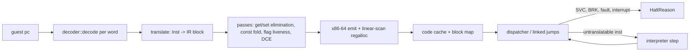

# A64 JIT design

This is the plan for `lichii-cpu`'s JIT. It sits behind the existing `CpuCore` contract, reuses the decoder's `Inst` stream, and keeps the interpreter as both its fallback and its test oracle. Nothing here changes a cross-crate contract. The proposals that would touch one are listed at the end and go through the Captain first.

## Goals

- Run Switch 1 and Switch 2 titles at full speed on x86-64 hosts (Linux and Windows), with the interpreter used only for code the JIT cannot translate yet.
- Bit-exact with the interpreter: every translated block must produce the same `ThreadContext` and memory as interpreting it. The differential suites enforce this.
- Remove the costs Lichii's dynarmic paid, as recorded in `NX2_NOTES.md`:
  - Row 3: LSE atomics, `CAS` and `SWP` ran as exclusive load/op/store retry loops. Here they become single host atomics on fastmem.
  - Rows 111 and 127: `CNTPCT_EL0` reads cost 10-23% of the main core. Here the counter is read inline, without a call out.
  - Row 109: ~1,400 SVCs per frame. Here leaving the JIT is a plain return, because the guest state already lives in `ThreadContext`.
  - Rows 115 and 150: page protection for GPU-tracked memory. Here fastmem faults go to a slow path per access site and do not crash the core.

Not goals for the first version: an AArch64 host backend (the IR stays host-neutral, so one can be added later), cycle-accurate timing, and translating SIMD/FP natively (the SIMD crew's `simd::execute` is called as a helper at first).

## Pipeline

Block boundaries are the interpreter's (`Inst::ends_block`, page ends), plus any instruction the translator rejects. A rejected instruction ends the block before it, and the dispatcher interprets that one instruction with `Exec::execute` before it re-enters translated code. So any decodable instruction always runs, and new IR coverage can grow one instruction class at a time.

## IR

The IR is SSA inside one block. There is no cross-block IR, and each block is a flat `Vec<IrInst>` that refers to values by index.

- **Types**: `U1`, `U8`, `U16`, `U32`, `U64`, `U128`, `Nzcv` (a packed 4-bit value), and `Void`. `U128` values live in their own register class (host `xmm` registers). J1 uses them for vector loads, stores and `GetVec`/`SetVec`. Lane ops (`VecExtract{size, lane}`, `VecInsert{size, lane}`) and the native SIMD/FP ops of J4 and J5 are new variants of the same op enum on `U128` values, so the SIMD crew can add lowerings without reshaping the IR.
- **State access**: `GetReg(r)`, `SetReg(r, v)`, `GetSp`/`SetSp`, `GetNzcv`/`SetNzcv`, `GetVec(n)`/`SetVec(n, v)`, and `GetSys`/`SetSys` for FPCR, FPSR and TPIDR. Writes to `ZR` are never emitted; the translator drops them using `Reg::ZR`.
- **Arithmetic**: add, sub, adc and sbc, each with an optional `Nzcv` result. Also logic ops, shifts and rotates with A64 semantics (amount masked by the width), extends, mul/umulh/smulh, udiv/sdiv with A64's divide-by-zero and overflow results, clz/cls/rbit/rev, select, the bitfield move (`(src ror r) & wmask` merges, folded at translate time because `immr`/`imms` are constant), crc32.
- **Conditions**: `TestCond(cond, nzcv) -> U1`.
- **Memory**: `Load{size, signed, order}` and `Store{size, order}` on a `U64` address. `order` is plain, acquire or release. Pair accesses are two ops on adjacent addresses.
- **Atomics**: `AtomicRmw{op, size}`, `Cas{size}`, `Cas128`, `ExclusiveLoad{size}`, `ExclusiveStore{size} -> U1`, `ClearExclusive`, `Fence`.
- **Calls**: `CallSimd(word)` runs `simd::execute` on the live context, `CallClock`, and `CallHelper(fn)` for rare operations (`DC ZVA`, structure loads at first).
- **Terminals** (exactly one, at the end): `Jump(const pc)`, `JumpIndirect(v, hint)` where the hint is `Ret`, `Call` or `Other`, `Branch(cond, taken pc, not-taken pc)`, `Halt(SupervisorCall | Breakpoint | Undefined)`, `Interpret(pc)`, `Invalidate(range)`.

Using an IR instead of emitting x86 straight from `Inst` is what makes the flag and register passes possible. Most A64 `ADDS`/`SUBS` flags are dead before they are read, and most guest registers are reused within a block.

## Passes

Each pass is a function `fn(&mut Block)`. They run in this order:

1. **Get/set elimination**: forwards the last `SetReg` to later `GetReg`s of the same register, drops dead `SetReg`s that a later write in the same block overwrites, and does the same for NZCV and the vector registers. Any op that can leave the block early (every memory access, every helper call) is a barrier for dropping writes: a `SetReg` before it is kept even when a later one overwrites the register. So the `ThreadContext` is exact at every exit, and a fault returns the same state the interpreter would. Forwarding values to later reads still crosses memory accesses, which cannot change registers. A helper call (`CallSimd`, `CallHelper`) may write any guest register, vector register or NZCV, so it commits every pending write and also ends forwarding: later reads after the call load from `ThreadContext` again.
2. **Constant folding and propagation**: folds pure ops on immediates, `ADRP + ADD` address chains, `MOVZ/MOVK` sequences and conditions on known flags. A `Branch` with a known condition becomes `Jump`.
3. **Flag liveness**: removes the `Nzcv` outputs nobody reads before the next full write. Within a block that is the common case. Flags are live at every exit, including the barrier ops of pass 1, so this is the NZCV case of pass 1 followed by DCE. Flags that only the context reads are written lazily: `SetLazyNzcv` stores the operands of the add, subtract or test and a code for which one, instead of packing NZCV. The first read of NZCV in translated code, a `Get(Nzcv)` or a `CallSimd`, runs a shared stub in the code cache that recomputes and packs the flags, and `Jit::run` does the same in Rust whenever translated code returns. So the context is exact everywhere outside translated code, and an eager NZCV write clears any pending lazy flags.
4. **Dead code elimination**: drops pure ops with no users. Memory ops, atomics, calls and terminals are roots.
5. **Peepholes for the backend**: fuses `SUBS`/`ADDS`/`ANDS` with the `TestCond` that consumes its flags into one x86 `cmp`/`test` + `jcc`/`setcc`/`cmovcc`, skipping the packed `Nzcv` value. The pass rewrites the `TestCond` into a `Compare` on the flag op's operands; the backend emits a `Compare` whose only user is a `Select`, an `FCSEL` or the `Branch` right at that user and consumes the host flags there. `FCSEL` after `FCMP` is not fused. A second `ucomiss` at the select would be exact only without FZ, because FZ flushes subnormal inputs before the compare. So it would need its own FPCR check and slow path, for about three instructions saved per select. `HI` and `LS` after an add or a test have no single x86 condition code, so they keep the packed path.

Pass tests run each block both with and without each pass, through the backend, and compare results. That turns every pass into its own differential test.

## Guest state and host registers

The JIT works directly on the existing `ThreadContext`, which is `#[repr(C)]`, plus a small `JitState` next to it: pointers to the interrupt flag and the indirect-branch table, the pending link site and the scratch spill area. No copy is made on entry or exit.

| Host register | Use |
|---|---|
| `r15` | `&mut ThreadContext` (guest X0-X30, SP, PC, NZCV in `pstate`, V0-V31, ...) |
| `r14` | fastmem arena base (`Fastmem::base`) |
| `r13` | `&JitState` |
| `rax rcx rdx rbx rsi rdi rbp r8-r12` | allocatable |

The register allocator is a linear scan over the block's SSA values. Guest registers are loaded lazily from `[r15 + off]` and written back at exits and before helper calls, which are the only points where the context must be exact. Values live across a helper call go to callee-saved host registers or to the spill area.

Both host OSes use one ABI. The entry trampoline and every helper the JIT calls are Rust `extern "sysv64"` functions, which Rust supports on x86-64 Windows too. So emitted code follows System V everywhere: no shadow space, and the trampoline saves only `rbx rbp r12-r15`. On Windows the Rust caller of the trampoline saves `rsi rdi xmm6-xmm15` itself, because it knows the callee clobbers them.

## Memory

- **Fastmem**, whenever `AddressSpace::fastmem()` is `Some` (the default; `Settings::cpu.fastmem`): an access of `n` bytes is `cmp addr, size - n; ja slow; mov dst, [r14 + addr]`, where `size` is `Fastmem::size()` (`2^32`, `2^36` or `2^39`). The check covers the whole access width, so no byte of the access can land outside the arena, whatever the address space size, and an unsigned compare cannot wrap. It costs one predicted branch and is never removed, whatever `CpuAccuracy` says. Unaligned accesses are fine on x86-64.
- **Faults**: every core of a process shares one arena, and `Fastmem::set_fault_handler` holds one handler per arena, so the handler cannot belong to one core. Each core installs the same function, which ignores the `data` word. It searches a process-wide, fixed-size table of code buffers: one slot per live code cache, each slot holding the buffer's start and end and a pointer to that buffer's `(host_pc, stub)` site table, all published with atomics. The handler finds the buffer that contains the faulting host pc, then binary-searches its site table, with no allocation and no locks, as the `FaultHandler` contract requires. A fault in core A's code happens on the thread running core A, and only that thread appends to A's site table, so the table never changes under the handler. A host pc in no buffer, or at no site, returns `false` and reaches the previous handler as before. The table lives in `lichii-cpu` and has 256 slots. A code cache clears its slot before it unmaps its region and frees its site table; that happens on the owning thread while none of its code runs, so no fault can be reading the table, and a later mapping at the same range cannot match the stale slot. When every slot is taken, the new core logs a warning and runs with fastmem off: every access takes the slow path, so none of its code can fault. Slots are freed when a `CpuCore` is dropped, so the kernel must drop a process's cores when the process exits; today `cpu_manager` keeps them until kernel shutdown, which the kernel crew needs to change before many processes run in one session. It then moves the host pc to the site's out-of-line slow path with `HostFault::set_pc`. The slow path calls `AddressSpace::read`/`write`, so MMIO-like trapped pages (rows 115 and 150) work, and a real fault becomes `CpuFault::Data` with the exact guest pc, which comes from the site table.
- **No fastmem**: J1 sends every access straight to the site's slow path. An inline walk of the two-level page table, with the slow path on a miss, comes later, using the same `translate` semantics; the JIT asks `lichii-memory` for no new API.
- **Acquire/release**: on x86-64 these are compiler-ordering only. `DMB`/`DSB` become `mfence`.

## Atomics and exclusives

- `LDADD` is `lock xadd` and `SWP` is `xchg`. `LDCLR`, `LDEOR`, `LDSET` and the min/max ops are `lock cmpxchg` loops. `CAS` is `lock cmpxchg` and `CASP` is `lock cmpxchg8b`/`cmpxchg16b`. All of them work on the fastmem pointer after an inline alignment check, so a misaligned access gives `CpuFault::Alignment` exactly as in the interpreter. This replaces dynarmic's exclusive retry loops (notes row 3).
- `LDXR`/`STXR` call `ExclusiveMonitor::read`/`write` as helpers in the first version. That is correct against the monitor's 128-bit CAS (bb474c6) and against plain stores from other cores. Inlining them needs the monitor contract change proposed below.

## Dispatch, linking and interrupts

- **Entry**: `CpuCore::run` calls the entry trampoline with the host code for `ctx.pc`. Translated code returns a `HaltReason` code in `rax`, so leaving for an SVC is just a store to `pc` and a `ret`.
- **Interrupts**: `InterruptHandle::signal` sets an `AtomicBool` that the JIT state points at. Every block entry does `cmp byte [flag], 0; jne exit`. That is one predicted branch, and it gives the interpreter's block-boundary latency without needing to patch code from another thread.
- **Direct linking**: `Jump` and `Branch` targets start as jumps to a stub that looks up or translates the target and patches the `jmp rel32` in place. Each block records its incoming links, so invalidating it re-points them at the stub.
- **Indirect branches**: `BR`, `BLR` and `RET` (which also covers all the folded `RETAA`/`RETAB`, ~115k sites in title 1) probe a 64K-entry direct-mapped `guest pc -> host code` table inline, then fall back to the dispatcher. There is no return stack buffer. One was built and measured (branch `cpu/jit-rsb-experiment`): pushing on every call cost about 0.6 ns (10-20% on the call/return bench loop), and avoiding a table miss saved about 1 ns, because the dispatcher round trip is cheap. So it pays off only when more than half of all returns miss the table, which needs hot return addresses colliding in the 64K slots. Revisit it with traces from real titles; the `colliding returns` bench loop is the worst case.
- **Code cache**: one per `CpuCore`, because `invalidate_code` is per core. One type owns the code memory, the block map and the fault-site table, so a cache shared by all cores of a process (six cores translating the same Switch 2 code) can replace it without touching the translator or the backend, once translation time is measured on real titles. From J3 it is a 64 MiB region mapped twice from one shared-memory object, read-write for the emitter and read-execute for running (`memfd` on Linux, `CreateFileMapping` on Windows), so linking and patching never need `mprotect`. When the region is full the cache is cleared and refilled.
- **Invalidation**: `invalidate_code`, `clear_code_cache`, `IC IVAU` and `IC IALLU` behave as in the interpreter. Guest `IC IVAU` and `IC IALLU` drop the range on the core that ran them and return `HaltReason::InvalidateCode`, so the kernel drops it on every other core of the process, as the hardware broadcast does. Blocks never cross a page, so a range lookup in the block map finds every overlapping block, and each one is unlinked and removed from the fast table and the indirect-branch table.

## Backend

The plan is **dynasm-rs** (`dynasmrt::VecAssembler` for x64), emitting into a `Vec<u8>` that is then copied into the code cache. It assembles at compile time with dynamic register operands, so the register allocator can choose registers at runtime. It supports Windows and has years of use. A hand-written encoder would be one more thing to debug, for no performance gain in code that runs only at translation time. If a dynasm limitation shows up, the backend is one module, and an `iced-x86` encoder can replace it without touching the IR.

## SIMD and floating point

Every instruction in the SIMD/FP data-processing group runs inside the block. The ones `jit/simd` lowers become `Op::Simd`, and every other one becomes `Op::CallSimd`, which calls the interpreter's `simd::execute` on the live `ThreadContext`. Get/set elimination commits pending writes before a `CallSimd` and forgets every known location after it, because the instruction can touch any guest state.

The lowered FP arithmetic (`FADD`, `FSUB`, `FMUL`, `FDIV`, the fused multiply-adds, `FSQRT`, `FCVT`, `SCVTF`/`UCVTF`, `FCVTZS`/`FCVTZU`, `FCMP`) is *checked*. The host computes the result only when the host and the Arm ARM must agree on both the value and the FPSR flags:

- FPCR selects round to nearest and FZ is clear. Every other rounding mode, and flush to zero, falls back.
- FPSR.IXC is already set whenever the op can be inexact, so the op never needs to report IXC. Titles set IXC within their first few FP ops and rarely clear it. While it is clear, the op falls back, and the fallback sets IXC when the result is inexact.
- The result is finite. Ops that can underflow also need a normal result above the smallest normal: the Arm ARM detects tininess before rounding and x86 after, and a zero or subnormal result may hide an underflow. Additions and subtractions of floats never round to a subnormal, so they accept any finite result.
- The integer conversions also check for the host's out-of-range value and for unsigned range. `FCMP` falls back on an unordered compare.

The fallback is an out-of-line slow path. It runs the original instruction through `CallSimd` and reloads the destination from the context. Because a checked op can fall back, it commits pending writes the same way an op that can exit does. The JIT never reads the MXCSR exception flags: under these conditions they would only repeat what FPSR already holds. Its control bits do matter, so `Jit::run` holds MXCSR at the default 0x1f80 (round to nearest, every exception masked, no FTZ or DAZ) while guest code runs, and restores the caller's value on exit. FZ titles need input and output denormal checks to stay native; that is future work.

Vector integer ops are exact on the host, so they are lowered without checks: three-same `ADD`, `SUB`, the bitwise ops, `CMEQ`/`CMGT`/`CMGE`/`CMHI`/`CMHS`, `MUL` on H and S, compares against zero, shifts by immediate, `MOVI`/`MVNI` and the `ORR`/`BIC` immediates, `DUP`, `INS`, `UMOV` and `SMOV`. Forms that need SSE4.1 or SSE4.2 (D compares, unsigned H/S compares, `MUL` on S, `INS` on B and S) are chosen at translate time and stay on `CallSimd` when the host lacks them; byte shifts, `SSHR .2D` and `CMHI`/`CMHS` on D always do. `LD1`/`ST1` with one to four registers become plain vector loads and stores. All loads come before any register write and the base writeback comes last, which matches the interpreter on a fault because `AddressSpace` splits a page-crossing access at the page and reports the first bad byte.

| Loop (`benches/cpu.rs`, 2M iterations) | Interpreter | JIT before J4 (block ends at SIMD) | JIT with `CallSimd` | JIT native |
|---|---|---|---|---|
| `scalar fp loop` (LDR S, FMUL, FADD, FMADD, FSUB, FCMP, FCSEL, FCVT, STR D) | 77 MIPS | 67 MIPS | 89 MIPS | ~1,450 MIPS |
| `vector int loop` (LD1, ADD, SUB, EOR, CMGT, USHR, DUP, UMOV, ST1) | 50 MIPS | 49 MIPS | 73 MIPS | ~2,750 MIPS |

## CRC32

`CRC32B/H/W/X` and `CRC32CB/H/W/X` become one `Op::Crc32`. Splatoon 3 ran 2.85M of them in 93 s of boot, 96% of all interpreter fallbacks. `CRC32C` is the SSE4.2 `crc32` instruction.

Plain `CRC32` has no x86 instruction, so it uses slicing-by-N: slice `k` of a 256-entry table maps a byte to its CRC followed by `k` zero bytes. Every byte of `crc ^ data` is then looked up at once and the results are XORed. That takes 1, 2, 4 or 8 independent loads instead of a chain of byte steps. `CRC32C` uses the same tables on hosts without SSE4.2.

On chained calls (latency, AMD EPYC), slicing beat a two- or three-multiply `pclmulqdq` Barrett reduction at every size:

| Size | Slicing | `pclmulqdq` |
|---|---|---|
| H | 2.4 ns | 6.2 ns |
| W | 2.9 ns | 5.1 ns |
| X | 5.7 ns | 8.6 ns |

A single byte-table step costs 2.2 ns for B. So slicing needs no CPU feature beyond SSE2.

## Accuracy settings

`CpuConfig::accuracy` carries `Settings::cpu.accuracy` to each core. It only controls what is safe to relax. Under `Unsafe`, flags at block exits may be treated as dead and the bounds check is kept. Under `Paranoid` `Jit::new` returns `None`, so `new_core` builds the interpreter. `Accurate` and `Auto` are identical to the interpreter.

## Testing

1. **JIT vs interpreter**: the Unicorn differential generators in `tests/differential.rs` take a `CpuCore`, so the same streams run on interpreter, JIT and Unicorn. Any disagreement fails the test.
2. **Single-instruction mode**: a debug setting translates one instruction per block, which isolates translator bugs from pass bugs.
3. **Pass ablation**: as described under Passes, each pass is checked by running blocks with and without it.
4. **Fault paths**: fastmem faults on unmapped and protected pages, from loads, stores, pairs and atomics. Each must give the same `CpuFault` and `pc` as the interpreter.
5. **Throughput**: `benches/interpreter.rs` grows a JIT column, and the target is at least 10x the interpreter on the integer loops.

## Profiling

`LICHII_JIT_PROFILE=1` turns on per-core counters that rank JIT work on real titles: J5's SIMD/FP lowerings and this file's remaining items. With the variable unset, no counter exists and every emitted block is byte-identical. The dispatcher pays one predicted `None` check per block exit.

- **What it counts**: interpreter fallbacks by `Inst` variant (`LD2`-`LD4` and `ST2`-`ST4` apart from the rest of `VecMulti`); `CallSimd` calls; slow paths of native FP ops, split into FPCR mode (FZ or a rounding mode) and inputs or a clear FPSR.IXC; dispatcher exits by reason (unlinked jump, indirect-branch miss, interrupt, fault); lazy NZCV write-backs by the native stub and by the dispatcher; code cache flushes (region full, clear, range invalidation); and translated blocks, instructions, code bytes and translation time. SIMD/FP words are grouped by the Arm ARM's top-level decode, and their register and immediate fields are masked out, so `FP 2-source 0x1e602800` is every double-precision `FADD`.
- **How**: each core counts into its own table without locks. The helpers behind `CallSimd` and the FP slow paths are swapped for counting wrappers, and the materialize stub gains an `inc`. When `run` returns, at most every 250 ms, a core sends its counts down a channel, unless the counts it sent last are still queued; in that case they keep accumulating in the core. So dispatch takes no lock, and the channel holds at most one message per core. The frame view and cores being dropped lock the process-wide total and drain the channel into it.
- **Output**: when the last profiled core drops (`System::stop` ends the session), the total is logged at info level as a table sorted by count. The frame view adds one line of per-second rates: translation milliseconds, interpreter fallbacks, and SIMD helper calls and slow paths.

## Milestones

1. **J1**: the IR, the translator for integer, branch and plain load/store `Inst`s, passes 1-4, the x64 backend with linear-scan allocation, the entry trampoline, unlinked dispatch, fastmem loads and stores with the bounds check, the fastmem fault handler and slow paths, and the interpreter fallback for everything else. Until J3 the code cache is one read-write-execute region. It must pass the JIT-vs-interpreter suite, fault paths included.
2. **J2**: host atomics (`LD<op>`, `SWP`, `CAS`) as single lock-prefixed instructions, `DC ZVA`, and `MRS CNTPCT` through a helper call. `CASP`, inline exclusives and the inline counter follow with the monitor-slot and `host_tsc_scale` contract PRs; until then they run on the interpreter.
3. **J3**: direct linking, the fast indirect table, the interrupt check at block entry and the dual-mapped code cache with invalidation. This is the main throughput step. The planned RSB was measured and left out (see Indirect branches).
4. **J4**: `CallSimd` mid-block instead of falling back, the flags/condition peephole (pass 5), native lowering of checked scalar FP arithmetic, and native vector integer ops, element moves and `LD1`/`ST1` (see SIMD and floating point).
5. **J5**: native lowering for the hottest SIMD/FP ops, measured on real titles, in agreement with the SIMD crew, since they own the semantics.

## Contract proposals (for the Captain; not needed for J1)

- **`ExclusiveMonitor` inline reservations** (lichii-memory): expose each core's reservation as a `#[repr(C)]` `{ addr, value: u128, size }` slot that only its own core writes, so `LDXR`/`STXR` become inline loads and `lock cmpxchg` instead of helper calls. Today `clear(core)` is the only cross-thread operation, and it already runs on the owning core's thread during a context switch.
- **`GuestClock` fast path** (lichii-cpu contract): `fn host_tsc_scale(&self) -> Option<TscScale>` with `(mul, shift, offset)`, so `MRS CNTPCT_EL0` becomes `rdtsc` plus a multiply-shift inline, instead of a dynamic call per read (notes rows 111 and 127). Returns `None` when the TSC is not invariant.
- **`new_core` settings** (done): `CpuConfig::accuracy: CpuAccuracy`. Fastmem is already implied by whether the `AddressSpace` has an arena.
